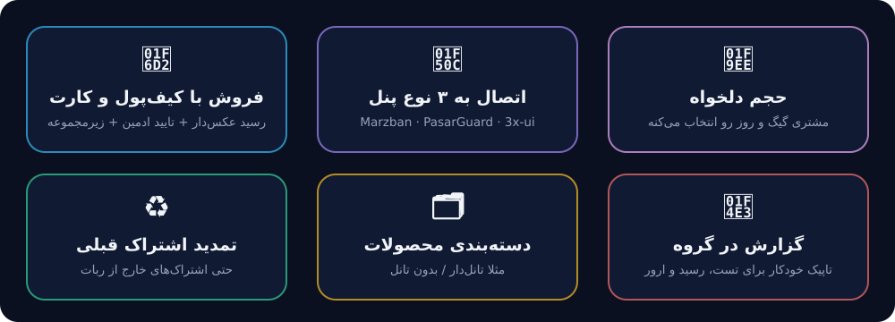

<p align="center">
  
</p>

<p align="center">
  
  
  
  
</p>

<p align="center">
  فروش کانفیگ با <b>کیف‌پول</b>، <b>کارت‌به‌کارت</b>، <b>زیرمجموعه‌گیری</b> و <b>گردونه شانس</b><br>
  اتصال خودکار به <b>Marzban / PasarGuard / 3x-ui (سنایی)</b> — همه‌چیز از داخل خود ربات مدیریت میشه ✨
</p>

<p align="center">
  <a href="#quickstart">🚀 راه‌اندازی سریع</a> ·
  <a href="#important">⚠️ نکته‌های مهم</a> ·
  <a href="#guide">📚 راهنمای کامل</a> ·
  <a href="#security">🔐 امنیت</a>
</p>

<p align="center"></p>

## ✨ قابلیت‌ها

<p align="center">
  
</p>

| بخش | توضیح |
|---|---|
| 🛒 خرید و تمدید | پلن ثابت یا **حجم دلخواه** (مشتری گیگ و روز رو انتخاب می‌کنه، قیمت خودکار حساب میشه)؛ تمدید واقعی روی همون اکانت پنل (ریست کامل از امروز) |
| 🔎 اشتراک قبلی | مشتری اسم اشتراکی که **بیرون از ربات** خریده رو می‌زنه ← مصرف/انقضا و تمدید (با پلن ثابت یا حجم دلخواه) |
| 🗂 دسته‌بندی | مثلا «تانل‌دار» و «بدون تانل»؛ مشتری اول دسته رو انتخاب می‌کنه، بعد پلن |
| 📲 QR کد | همراه هر لینک اشتراک (ساخته‌شده داخل خود Worker، بدون سرویس بیرونی) |
| 💳 پرداخت | کیف‌پول یا کارت‌به‌کارت با عکس رسید و تایید ادمین؛ کمیسیون زیرمجموعه‌گیری |
| 🎨 ظاهر | رنگ دکمه‌ها (آبی/سبز/قرمز)، تغییر متن، خاموش/روشن کردن هر دکمه، متن قوانین با دکمه سبز تایید |
| 📣 گزارش | گروه تاپیک‌دار: تست رایگان، رسیدها، خریدها، شارژ، کاربران جدید و خطاها |
| 🛠 مدیریت | همه‌چیز از داخل ربات: پنل‌ها، محصولات، کاربران، آمار، پیام همگانی |

### 🔄 مسیر یک خرید

<p align="center">
  
</p>

<p align="center"></p>

<a name="important"></a>
## ⚠️ نکته‌های مهم

### ۱) پنل باید روی «دامنه با SSL معتبر» باشه، نه IP
Cloudflare Workers به آدرس IP خام وصل نمیشه (خطای ۱۰۰۳) و طبق منابعی که پیدا کردم پورت‌های غیراستاندارد (مثل ۸۰۰۰/۲۰۵۳) رو هم ممکنه نادیده بگیره.
پنل رو روی یه دامنه/ساب‌دامین، پورت **۴۴۳** و SSL واقعی بذار (Nginx/Caddy یا Cloudflare Tunnel رایگان). ربات IP رو موقع افزودن رد می‌کنه و بعد از ذخیره «تست اتصال» می‌زنه.

### ۲) محدودیت‌های پلن رایگان Worker
- هر درخواستِ ورودی حداکثر ~۵۰ تماس خروجی (تلگرام/پنل/دیتابیس) و حدود ۱۰ms زمان CPU داره.
- ساخت QR حدود ۳–۴ms CPU می‌گیره (اندازه‌گیری شده) و روی پلن رایگان جا میشه؛ اگه فروشت زیاد شد یا به خطای CPU خوردی، پلن پولی Workers (حدود ۵ دلار در ماه) رو بگیر یا QR رو از «🔎 اشتراک قبلی و QR» خاموش کن.
- **پیام همگانی** روی پلن رایگان فقط برای حدود ۴۵ نفر اول کار می‌کنه (هر پیام یک تماس خروجیه). برای کاربر بیشتر پلن پولی لازمه.

### ۳) رنگ دکمه‌ها فقط روی تلگرام به‌روز دیده میشه
`style` از فوریه ۲۰۲۶ توسط تلگرام اضافه شده؛ کلاینت‌های قدیمی‌تر دکمه معمولی می‌بینن. اگه تلگرام استایل رو نپذیره ربات خودش بدون استایل دوباره می‌فرسته.
برای خاموش کردن کامل رنگ‌ها: `wrangler secret put NO_BUTTON_STYLE` با مقدار `1`.

<p align="center"></p>

<a name="quickstart"></a>
## 🚀 راه‌اندازی سریع

### نصب از صفر
```powershell
cd config-sales-bot
wrangler d1 create config-sales-bot-db
# database_id رو داخل wrangler.toml بذار
wrangler d1 execute config-sales-bot-db --remote --file=./schema.sql
wrangler secret put BOT_TOKEN
wrangler secret put ADMIN_IDS
wrangler secret put WEBHOOK_SECRET
wrangler deploy
```
Webhook (یک‌بار):
```
https://api.telegram.org/bot<TOKEN>/setWebhook?url=https://<worker>.workers.dev/webhook/<WEBHOOK_SECRET>&allowed_updates=["message","callback_query","chat_member"]
```

### ارتقا از نسخه‌های قبلی
هر کدوم از فایل‌های زیر که **قبلا اجرا نکردی** رو به ترتیب و **هرکدوم فقط یک بار** اجرا کن، بعد دیپلوی:
```powershell
wrangler d1 execute config-sales-bot-db --remote --file=./migration_v2.sql   # اتصال به پنل‌ها
wrangler d1 execute config-sales-bot-db --remote --file=./migration_v3.sql   # حجم دلخواه
wrangler d1 execute config-sales-bot-db --remote --file=./migration_v4.sql   # اشتراک قبلی + QR
wrangler d1 execute config-sales-bot-db --remote --file=./migration_v5.sql   # دسته‌بندی محصولات (اختیاری؛ ربات خودش جدول رو می‌سازه)
wrangler deploy
```
(اگه یکی رو دوباره اجرا کنی ارور `duplicate column` می‌ده؛ بی‌خطره و یعنی قبلا اجرا شده. دقت کن `--remote` و `--file` **دو خط تیره** دارن.)
قوانین، رنگ‌ها و تنظیمات ظاهر نیاز به مایگریشن ندارن.

---

<p align="center"></p>

<a name="guide"></a>
## 📚 راهنمای کامل
> هر بخش رو با کلیک باز کن 👇

<details>
<summary><b>🔌 پنل‌ها (از داخل ربات)</b></summary>

«🛠 پنل مدیریت ← 🔌 مدیریت پنل‌ها ← ➕ افزودن پنل». فیلدها با `|` جدا میشن (برای فیلد خالی `-`). بعد از ارسال، پیام حاوی رمز پاک میشه و تست اتصال اجرا میشه.

| پنل | فرمت |
|---|---|
| **Marzban** | `نام \| آدرس \| یوزرنیم \| پسورد \| آدرس ساب (اختیاری) \| پروتکل‌ها (اختیاری) \| flow (اختیاری)` |
| **PasarGuard** | `نام \| آدرس \| یوزرنیم \| پسورد \| آدرس ساب (اختیاری) \| آیدی گروه‌ها (اختیاری) \| flow (اختیاری)` |
| **3x-ui (سنایی)** | `نام \| آدرس کامل با مسیر مخفی \| یوزرنیم \| پسورد \| آیدی اینباند \| آدرس ساب \| توکن API (اختیاری) \| flow (اختیاری)` |

- **سنایی**: «آدرس ساب» همونیه که توی تنظیمات Subscription پنل هست (مثل `https://sub.example.com:2096/sub`). نسخه‌های قدیمی و جدید (CSRF، توکن API) پشتیبانی میشن؛ پروتکل‌های vless/vmess/trojan.
- **PasarGuard**: اگه گروه ندی کاربر جدید در همه گروه‌ها ساخته میشه. **Marzban**: پیش‌فرض پروتکل `vless`؛ برای Reality `flow` رو `xtls-rprx-vision` بذار.
- برای ربات یه **ادمین جدا** در هر پنل بساز (نه ادمین اصلی).

</details>

<details>
<summary><b>🛒 محصولات</b></summary>

«🛒 مدیریت محصولات»:
- **محصول عادی**: `نام | قیمت | مدت(روز)` → بعد «🔌 اتصال به پنل» و «📊 تنظیم حجم (گیگ)». بدون اتصال به پنل، کانفیگ‌ها دستی از انبار تحویل داده میشن.
- **🧮 حجم دلخواه**: `نام | حداقل گیگ | حداکثر گیگ | حداقل روز | حداکثر روز | قیمت هر گیگ | قیمت هر روز (اختیاری) | توضیحات`
  مثال: `حجم دلخواه | 5 | 200 | 30 | 365 | 2000 | 100` ← قیمت = (گیگ × ۲۰۰۰) + (روز × ۱۰۰). حتماً به یه پنل وصلش کن (تا وصل نشه برای مشتری نمایش داده نمیشه). قیمت همیشه لحظه‌ی پرداخت دوباره حساب میشه. ارقام فارسی هم پذیرفته میشن.
- **🆓 تست رایگان**: محصول با قیمت ۰ بساز، حجم/مدت کم بده و «تنظیم بعنوان تست رایگان» رو بزن.

</details>

<details>
<summary><b>🗂 دسته‌بندی محصولات</b></summary>

مثلا دو پنل داری: یکی «تانل‌دار» و یکی «بدون تانل».
1. ادمین: «🛒 مدیریت محصولات ← 🗂 دسته‌بندی‌ها ← ➕ افزودن دسته‌بندی» (مثلا `🚇 تانل‌دار` و `⚡️ بدون تانل`).
2. داخل هر دسته: «🔌 افزودن همه‌ی محصولات یک پنل» ← پنل رو انتخاب کن تا همه‌ی محصولاتش یکجا بره توی اون دسته. (یا برای هر محصول جدا: «لیست محصولات ← محصول ← 🗂 دسته‌بندی».)
3. مشتری موقع «🛍 خرید اشتراک» اول دسته‌ها رو می‌بینه و بعد پلن‌های همون دسته. محصولات بدون دسته زیر «📦 سایر» میان؛ اگه هیچ دسته‌ای نسازی همه‌چی مثل قبله.
- دسته‌ی غیرفعال‌شده (و محصولاتش) برای مشتری نمایش داده نمیشه. حذف دسته، محصولات رو پاک نمی‌کنه و فقط «بدون دسته» میشن.
- نیازی به اجرای دستی مایگریشن نیست؛ ربات جدول دسته‌بندی رو خودش می‌سازه (`migration_v5.sql` فقط برای اجرای دستی هست).

</details>

<details>
<summary><b>🔎 اشتراک‌های خارج از ربات</b></summary>

مشتری دکمه «🔎 استعلام/تمدید اشتراک قبلی» رو می‌زنه و **اسم اشتراکش** (یوزرنیم روی پنل) رو می‌فرسته. ربات همه‌ی پنل‌های فعال رو جستجو می‌کنه و **وضعیت، مصرف، باقی‌مانده و انقضا** رو نشون میده.
- **تمدید**: با پلن‌های عادی/فعالی که به **همون پنل** وصل کردی. ریست کامل: مصرف صفر و حجم/مدت جدید از امروز حساب میشه (روزهای باقی‌مانده‌ی قبلی اضافه نمیشن)؛ بقیه‌ی تنظیمات اکانت (flow، محدودیت IP، ...) دست‌نخورده می‌مونه. پرداخت: کیف‌پول یا کارت‌به‌کارت.
- **لینک ساب + QR** و تمدید، بعد از اتصال به حساب تلگرام مشتری، توی «📦 سرویس‌های من» هم میاد.
- ♻️ **تمدید با حجم دلخواه**: توی لیست پلن‌های تمدید اشتراک قبلی، محصول‌های «🧮 حجم دلخواه» که به همون پنل وصلن هم میان؛ مشتری حجم و مدت رو خودش انتخاب می‌کنه، قیمت خودکار حساب میشه و تمدید روی همون اکانت انجام میشه (پرداخت با کیف پول یا کارت‌به‌کارت).
- 🔐 **تایید مالکیت (پیش‌فرض: روشن)**: اسم اشتراک‌ها قابل حدس‌زدنه (مثل `ali1`) و لینک ساب مثل رمز عبوره؛ برای همین قبل از تمدید، مشتری باید **لینک اشتراک فعلیش** رو بفرسته (۳ تلاش، حداکثر ۱۲ استعلام در ۱۰ دقیقه). اگه می‌خوای فقط با اسم کار کنه: «🔎 اشتراک قبلی و QR ← خاموش کردن تایید مالکیت» (⚠️ ناامنه).
- اگه اشتراک روی پنل سنایی `subId` نداشته باشه، لینک ساب وجود نداره و با تایید مالکیت روشن امکان‌پذیر نیست.

</details>

<details>
<summary><b>📲 QR کد</b></summary>

همراه هر لینک (خرید، تمدید، تست) QR هم فرستاده میشه و زیر «سرویس‌های من» دکمه‌ی QR هست. QR **داخل خود Worker** ساخته میشه؛ لینک اشتراک هیچ‌وقت به سرویس بیرونی داده نمیشه.
خاموش/روشن: «🔎 اشتراک قبلی و QR».

</details>

<details>
<summary><b>🎨 شخصی‌سازی</b></summary>

- **قوانین**: «📜 قوانین» ← ویرایش متن (HTML مجازه؛ متن نامعتبر ذخیره نمیشه)، متن دکمه، روشن/خاموش. هر کاربر قبل از هر کاری یک‌بار با دکمه‌ی **سبز** می‌پذیره (کاربرهای قبلی هم یک‌بار می‌پذیرن). ادمین‌ها مسدود نمیشن.
- **دکمه‌ها**: «🎨 شخصی‌سازی دکمه‌ها» ← هر دکمه‌ی منو: تغییر متن، رنگ (آبی/سبز/قرمز/بدون رنگ) و **🔴 خاموش/روشن** (خاموش = از منو برداشته میشه و حتی با تایپ دستی/دکمه‌های قدیمی هم کار نمی‌کنه). رنگ دسته‌های دکمه‌های شیشه‌ای هم قابل تغییره.
- تغییر متن/رنگ کیبورد برای هر کاربر از `/start` بعدی (یا اولین پیام همگانی) اعمال میشه؛ متن‌های قبلی همچنان کار می‌کنن.

---

</details>

<details>
<summary><b>📣 گروه گزارش (تاپیک‌بندی خودکار)</b></summary>

1. یه گروه بساز و توی تنظیماتش **Topics** رو روشن کن (گروه میشه فروم).
2. ربات رو توی گروه اضافه کن و **ادمین** کن (دسترسی **Manage Topics** حتما).
3. توی گروه دستور `/setlog` رو بفرست (فقط ادمین‌های `ADMIN_IDS`). ربات تاپیک‌ها رو خودش می‌سازه.
4. دستورات دیگه: `/logtest` (پیام تست) و `/unsetlog` (قطع گزارش). از پنل ادمین هم «📣 گروه گزارش» همین کارها + روشن/خاموش کردن هر تاپیک رو داره.

تاپیک‌ها: 👤 کاربران (عضو جدید/خروج از کانال اجباری) — 🎁 تست رایگان — 🧾 رسیدها (عکس رسید + تایید/رد) — 🛒 خرید و تمدید (با کیف پول/کارت‌به‌کارت، شامل تمدید اشتراک قبلی) — 💰 کیف پول (شارژ) — ⚠️ خطاها (خطای ساخت سرویس/پنل، تموم شدن موجودی تست، خطای کد ربات).
- اگه یه تاپیک رو پاک کنی، دفعه‌ی بعد که گزارشی بیاد دوباره ساخته میشه.
- اگه گروه فروم نباشه یا دسترسی نداشته باشه، گزارش‌ها بدون تاپیک توی خود گروه میان.
- لینک اشتراک/کانفیگ مشتری توی گزارش‌ها نمیاد.
- پیام‌های عادی توی گروه‌ها نادیده گرفته میشن؛ ربات فقط دستورات بالا رو از ادمین‌ها می‌پذیره.

</details>


<p align="center"></p>

<a name="security"></a>
## 🔐 امنیت و محدودیت‌ها

### امنیت
- توکن‌ها و رمزها رو هیچ‌جا (حتی چت‌ها) منتشر نکن؛ هر توکنی که لو رفته رو عوض کن (BotFather ← Revoke، توکن API کلادفلر).
- اطلاعات ورود پنل‌ها داخل D1 حساب خودت ذخیره میشه (متن ساده) — برای همین ادمین جدا بساز.
- فقط آیدی‌های `ADMIN_IDS` به پنل مدیریت دسترسی دارن؛ هر سفارش قفل اتمیک داره (دوبار «تایید» دو سرویس نمی‌سازه) و کسر کیف‌پول اتمیکه.

### محدودیت‌های شناخته‌شده
- API پنل‌ها رو از کد کتابخانه‌های رسمی‌شون استخراج و با پنل‌های **شبیه‌سازی‌شده** تست کردم؛ **روی پنل واقعی تو هنوز تست نشده**. اگه خطا داد، پیام خطا (به فارسی) برای ادمین میاد؛ همون رو بفرست.
- جستجوی اشتراک سنایی کل اینباندها رو می‌خونه؛ روی پنل‌های خیلی بزرگ (هزاران کلاینت) ممکنه از سقف CPU پلن رایگان رد بشه.
- «سرویس‌های من» مصرف زنده رو برای ۵ سرویس آخر (+۵ اشتراک قبلی) می‌گیره.
- shadowsocks در سنایی برای *ساخت* کاربر جدید پشتیبانی نمیشه (تمدید اشتراک موجود شدنیه).
- یادآوری خودکار انقضا/اتمام حجم هنوز نیست (با Cron Trigger قابل اضافه‌کردنه).

<p align="center"><sub>ساخته‌شده برای Cloudflare Workers ⚡ — اگه خطایی دیدی، پیام خطای ربات رو همون‌طور که هست بفرست.</sub></p>
