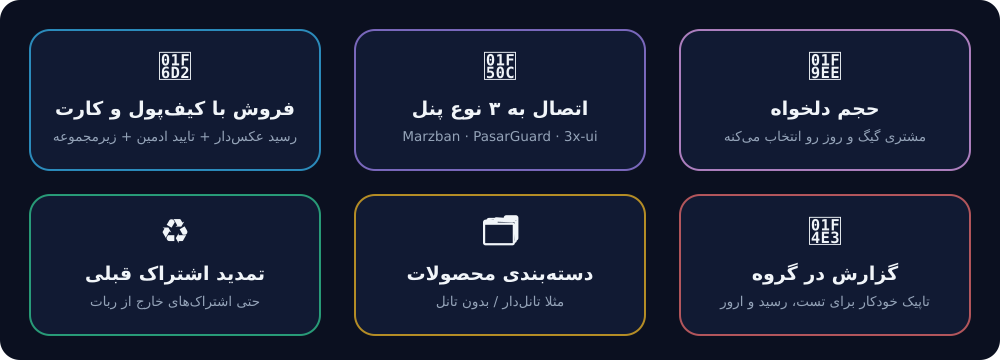

<p align="center">
  
</p>

<p align="center">
  
  
  
  
  
  
</p>

<p align="center">
  فروش کانفیگ با <b>کیف‌پول</b>، <b>کارت‌به‌کارت</b>، <b>زیرمجموعه‌گیری</b> و <b>گردونه شانس</b><br>
  اتصال خودکار به <b>Marzban / PasarGuard / 3x-ui (سنایی)</b> — مدیریت کامل از داخل ربات یا از <b>پنل وب</b> ✨
</p>

<p align="center">
  <a href="#panel">🖥 پنل وب</a> ·
  <a href="#platform">🧭 کدوم پلتفرم؟</a> ·
  <a href="#quickstart">🚀 راه‌اندازی</a> ·
  <a href="#railway">🚂 Railway</a> ·
  <a href="#important">⚠️ نکته‌های مهم</a> ·
  <a href="#guide">📚 راهنمای کامل</a> ·
  <a href="#security">🔐 امنیت</a>
</p>

<p align="center"></p>

## ✨ قابلیت‌ها

<p align="center">
  
</p>

| بخش | توضیح |
|---|---|
| 🛒 خرید و تمدید | پلن ثابت یا **حجم دلخواه** (مشتری گیگ و روز رو انتخاب می‌کنه، قیمت خودکار حساب میشه)؛ تمدید واقعی روی همون اکانت پنل (ریست کامل از امروز) |
| 🔎 اشتراک قبلی | مشتری اسم اشتراکی که **بیرون از ربات** خریده رو می‌زنه ← مصرف/انقضا و تمدید (با پلن ثابت یا حجم دلخواه) |
| 🗂 دسته‌بندی | مثلا «تانل‌دار» و «بدون تانل»؛ مشتری اول دسته رو انتخاب می‌کنه، بعد پلن |
| 📲 QR کد | همراه هر لینک اشتراک (ساخته‌شده داخل خود Worker، بدون سرویس بیرونی) |
| 💳 پرداخت | کیف‌پول یا کارت‌به‌کارت با عکس رسید و تایید ادمین؛ کمیسیون زیرمجموعه‌گیری |
| 🎨 ظاهر | رنگ دکمه‌ها (آبی/سبز/قرمز)، تغییر متن، خاموش/روشن کردن هر دکمه، متن قوانین با دکمه سبز تایید |
| 📣 گزارش | گروه تاپیک‌دار: تست رایگان، رسیدها، خریدها، شارژ، کاربران جدید و خطاها |
| ⚡ نصب با ویزارد | آدرس + `/install`: توکن، ادمین (تشخیص خودکار)، رمز پنل و ست‌کردن وب‌هوک، روی Cloudflare و Railway؛ [جزئیات](#quickstart) |
| 🖥 پنل وب | داشبورد، رسیدها (با عکس)، کاربران، محصولات، پنل‌های VPN، همه‌ی تنظیمات، پیام همگانی، آمار مصرف و بکاپ/بازیابی؛ [توضیح کامل](#panel) |
| 🚆 دو پلتفرم | همون کد روی Cloudflare Workers (D1) یا Railway (SQLite)؛ بکاپ بین دو پلتفرم قابل انتقاله |
| 🛠 مدیریت | همه‌چیز هم از داخل ربات و هم از پنل وب: پنل‌ها، محصولات، کاربران، آمار، پیام همگانی |

### 🔄 مسیر یک خرید

<p align="center">
  
</p>

<p align="center"></p>

<a name="panel"></a>
## 🖥 پنل وب

آدرس پنل = آدرس سرویس + `/panel` (مثلا `https://xxx.workers.dev/panel` یا `https://xxx.up.railway.app/panel`). فارسی و راست‌به‌چین، تم تیره و سازگار با موبایل (از منوی مرورگر می‌تونی به صفحه‌ی اصلی گوشی اضافه‌اش کنی).

### ورود
1. **از داخل ربات:** به‌عنوان ادمین دستور `/panel` رو بفرست؛ لینک ورود **یک‌بار مصرف و ۵ دقیقه‌ای** می‌گیری.
2. **با رمز:** متغیر `PANEL_PASSWORD` رو ست کن و رمز رو توی صفحه‌ی ورود بزن (بعد از ۸ تلاش اشتباه، ۱۰ دقیقه قفل میشه).

نشست ۷ روز اعتبار داره. برای باطل‌کردن همه‌ی نشست‌ها `SESSION_SECRET` رو عوض کن (اگه نذاشتی‌اش، `PANEL_PASSWORD` رو).

### بخش‌ها
| بخش | کارها |
|---|---|
| **داشبورد** | فروش امروز و ۷/۳۰ روز، کاربران، نمودار ۱۴ روزه، رسیدهای در انتظار (تایید/رد سریع)، هشدار موجودی و مصرف منابع |
| **پنل‌های VPN** | افزودن/ویرایش Marzban، PasarGuard و 3x-ui، تست اتصال |
| **محصولات و تعرفه‌ها** | پلن ثابت، حجم دلخواه، تست رایگان، دسته‌بندی، انبار کانفیگ (افزودن گروهی) |
| **رسیدها و سفارش‌ها** | فیلتر و جستجو، دیدن عکس رسید، تایید (تحویل خودکار سرویس) و رد |
| **بهینه‌ساز و مصرف** | آمار کش و KV؛ روی Cloudflare مصرف Worker/KV/D1؛ روی Railway منابع سرور و صف درخواست‌ها |
| **کاربران و کیف‌پول** | جستجو، مسدود/آزاد، افزایش/کاهش موجودی (با اطلاع به کاربر)، پیام تکی، **پیام همگانی** |
| **بکاپ و بازیابی** | دانلود بکاپ (JSON یا SQL فشرده)، ارسال به تاپیک «💾 بکاپ»، بازیابی |
| **سیستم و استقرار** | وضعیت ربات و وبهوک، تنظیم/حذف وبهوک، چک‌لیست متغیرها |
| **تنظیمات ربات** | شماره کارت، متن پشتیبانی/آموزش، درصد زیرمجموعه، دکمه‌ها و رنگ‌ها، **چیدمان منو**، قوانین، متن خوش‌آمد، گردونه، کانال اجباری، گروه گزارش |

### 📢 پیام همگانی از پنل
از همون موتور خود ربات استفاده می‌کنه (پیش‌نمایش برای ادمین، گزارش موفق/بلاک‌کرده/ناموفق، توقف، ادامه بعد از ری‌استارت). توی پنل نوار پیشرفت زنده می‌بینی. روی **Cloudflare** تا وقتی پنجره باز باشه خود پنل هر چند ثانیه یک «تیک» ۴۰ نفره می‌زنه (سریع‌تر از Cron هر دقیقه)، و اگه ببندی‌اش Cron ادامه می‌ده.

### 🧩 چیدمان منوی ربات
از **تنظیمات ربات ← چیدمان منو** جای دکمه‌های منوی اصلی رو عوض کن: دکمه‌ها رو بکش و رها کن (یا برای موبایل از فلش‌های ↑ ↓ → ← استفاده کن)، دکمه‌ها رو توی یک ردیف کنار هم بذار یا تک‌ردیفی کن (حداکثر ۴ دکمه در ردیف). پیش‌نمایش با رنگ و متن واقعی دکمه‌هاست و دکمه‌های پنهان کم‌رنگ نشون داده میشن.
- چیدمان با اولین پیامی که ربات برای هر کاربر می‌فرسته (مثلا بعد از `/start`) روی کیبوردش میاد.
- دکمه‌ای که توی چیدمان نباشه، تک‌ردیفی ته منو میاد؛ «پنل مدیریت» فقط برای ادمین‌ها نمایش داده میشه، هرجا که بذاری.
- متن، رنگ و پنهان‌بودن هر دکمه از تب «دکمه‌ها» تنظیم میشه و با چیدمان هم‌زمان کار می‌کنه.
- ترتیب چپ/راست داخل تلگرام ممکنه بسته به زبان برنامه‌ی کاربر فرق کنه؛ بعد از ذخیره یک‌بار توی تلگرام خودت چک کن. «بازگشت به پیش‌فرض» چیدمان اصلی رو برمی‌گردونه.

### ⚡ بهینه‌ساز
- **هر دو پلتفرم:** همه‌ی تنظیمات ربات با «یک» کوئری خونده و ۱۵ ثانیه توی حافظه کش میشه (به‌جای یک کوئری برای هر تنظیم). اگه **KV** وصل باشه یه نسخه‌ی مشترک هم اونجا هست که فقط موقع تغییر تنظیمات نوشته میشه (سقف نوشتن KV پلن رایگان ۱۰۰۰ بار در روزه). KV **اختیاریه**. روی Railway KV داخل همون فایل SQLite ساخته میشه.
- **فقط Railway:** صف نرخ تلگرام (~۲۵ پیام در ثانیه + فاصله برای هر چت) با تلاش مجدد خودکار روی خطای 429، حذف آپدیت تکراری تلگرام، صف ترتیبی برای هر کاربر، ادغام درخواست‌های GET هم‌زمان و تایم‌اوت ۲۵ ثانیه‌ای.

### 💾 بکاپ از پنل
| فرمت | ویژگی |
|---|---|
| **JSON** | روی هر پلتفرمی از همین پنل بازیابی میشه (جایگزینی کامل یا ادغام). جدول `state` فقط اسم‌های دلخواه سرویس‌ها رو نگه می‌داره |
| **SQL فشرده (`.sql.gz`)** | همون فرمت بکاپ شبانه؛ روی Railway از پنل بازیابی میشه (و با `/restore/<WEBHOOK_SECRET>`)، روی Cloudflare با `wrangler d1 execute` |

قبل از هر بازیابی، یک بکاپ ایمنی از وضعیت فعلی دانلود میشه. دانلود و بازیابی توی تاپیک «💾 بکاپ» گروه گزارش لاگ میشن. **فایل بکاپ شامل رمز پنل‌های VPN هم هست؛ جای امن نگهش دار.**

### آمار مصرف Cloudflare (اختیاری)
```powershell
wrangler secret put CF_API_TOKEN     # توکن با دسترسی Account Analytics: Read
wrangler secret put CF_ACCOUNT_ID
```
و `D1_DATABASE_ID` (و اگه KV داری `KV_NAMESPACE_ID`) رو در `[vars]` فایل `wrangler.toml` پر کن. KV رو هم با `wrangler kv namespace create CACHE` بساز و بخش `[[kv_namespaces]]` رو از کامنت دربیار.

<p align="center"></p>

<a name="platform"></a>
## 🧭 کدوم پلتفرم؟
همون کد روی هر دو اجرا میشه و بکاپ بینشون قابل انتقاله؛ پس می‌تونی با یکی شروع کنی و بعدا بری سراغ اون یکی.

| | ☁️ Cloudflare Workers | 🚂 Railway |
|---|---|---|
| **نوع** | سرورلس؛ Worker + دیتابیس D1 | سرور همیشه‌روشن؛ Node 22 + SQLite روی Volume |
| **هزینه** | پلن رایگان برای شروع کافیه | معمولا هزینه‌ی ماهانه داره (قیمت و اعتبار رایگان رو از خود Railway چک کن) |
| **محدودیت اجرا** | روی پلن رایگان: حدود ۱۰ms CPU و ~۵۰ تماس خروجی در هر درخواست | ندارد |
| **پیام همگانی** | هر دقیقه ۴۰ نفر (از پنل وب سریع‌تر) | ~۲۵ پیام در ثانیه تا آخر، حتی با ری‌استارت |
| **بهینه‌ساز** | کش تنظیمات (حافظه + KV اختیاری) | کش تنظیمات + صف نرخ تلگرام + حذف آپدیت تکراری + صف ترتیبی هر کاربر |
| **نصب** | `wrangler deploy` ← `/install` | GitHub ← Volume + دامنه ← `/install` |
| **نگهداری** | تقریبا هیچ | حتما Volume؛ فقط **یک** replica (SQLite) |

<p align="center"></p>

<a name="quickstart"></a>
## 🚀 راه‌اندازی

### ⚡ نصب با ویزارد (پیشنهادی، هر دو پلتفرم)
بعد از دیپلوی، آدرس سرویس + `/install` رو باز کن. دیگه نیازی به ست‌کردن دستی توکن و وب‌هوک نیست:

| گام | چی می‌پرسه |
|---|---|
| ۱ | **توکن ربات** (با `getMe` چک میشه) |
| ۲ | **آیدی ادمین**: با زدن Start در ربات **خودکار شناسایی** میشه (فقط روی https)، یا دستی |
| ۳ | **رمز پنل وب** |
| ۴ | تایید ← **ست‌شدن وب‌هوک**، پیام تایید برای ادمین‌ها، ورود مستقیم به پنل |

**«کد نصب» چیه؟** بدونش هر کسی که زودتر از تو به `/install` برسه (آدرس‌ها از لاگ‌های گواهی SSL پیدا میشن) می‌تونه ربات خودش رو روی سرویس تو نصب کنه. پس همه‌ی گام‌ها پشت یک کد قفلن (۸ تلاش اشتباه = ۱۰ دقیقه قفل) و بعد از نصب `/install` بسته میشه:
- **Cloudflare:** خودت توی `wrangler.toml` مقدار `INSTALL_CODE` رو می‌ذاری.
- **Railway:** اگه `INSTALL_CODE` نذاری، سرور موقع بالا اومدن یکی می‌سازه و توی **لاگ‌های سرویس** چاپ می‌کنه.

**چی کجا ذخیره میشه؟**
- توکن، آیدی ادمین‌ها و **هش** رمز پنل داخل دیتابیس همین سرویس (D1 یا SQLite) ذخیره میشن. توکن ناچار متن ساده‌ست (مثل رمز پنل‌های VPN).
- این مقدارها **توی بکاپ‌ها، بازیابی‌ها و کش KV نمیان** و بازیابی هم هیچ‌وقت بازنویسی‌شون نمی‌کنه.
- **متغیرهای محیطی همیشه اولویت دارن.** اگه `BOT_TOKEN` و `ADMIN_IDS` و `WEBHOOK_SECRET` رو خودت ست کرده باشی ویزارد اصلا باز نمیشه و دیپلوی‌های قبلی بدون تغییر کار می‌کنن.
- بعد از نصب: **پنل ← سیستم و استقرار ← اتصال و دسترسی** برای تغییر ادمین‌ها، رمز و توکن (فقط مقدارهایی که از دیتابیس میان؛ مقدار متغیرهای محیطی رو از خود پلتفرم عوض کن).
- رمز پنل رو فراموش کردی؟ متغیر `PANEL_PASSWORD` رو موقتا ست کن (اولویت داره)، وارد شو و از همون کارت رمز جدید بذار، بعد متغیر رو پاک کن.


### ☁️ Cloudflare Workers

**نصب با ویزارد**
```powershell
cd config-sales-bot
wrangler d1 create config-sales-bot-db      # database_id رو داخل wrangler.toml بذار
# در wrangler.toml بخش [vars]: INSTALL_CODE رو یک کد دلخواه (حداقل ۶ کاراکتر) بذار
wrangler deploy
```
بعد `https://<worker>.workers.dev/install` رو باز کن. جدول‌ها رو ویزارد خودش می‌سازه؛ لازم نیست `schema.sql` رو اجرا کنی.

**نصب دستی (با متغیرها)**
```powershell
wrangler d1 create config-sales-bot-db
# database_id رو داخل wrangler.toml بذار
wrangler d1 execute config-sales-bot-db --remote --file=./schema.sql
wrangler secret put BOT_TOKEN
wrangler secret put ADMIN_IDS
wrangler secret put WEBHOOK_SECRET
wrangler secret put PANEL_PASSWORD   # اختیاری (ورود به پنل وب با رمز)
wrangler deploy
```
بعد وب‌هوک رو از **پنل ← سیستم و استقرار ← تنظیم وب‌هوک** ست کن، یا دستی (یک‌بار):
```
https://api.telegram.org/bot<TOKEN>/setWebhook?url=https://<worker>.workers.dev/webhook/<WEBHOOK_SECRET>&allowed_updates=["message","callback_query","chat_member"]
```

**اختیاری:** KV برای کش مشترک تنظیمات (`wrangler kv namespace create CACHE` و فعال‌کردن بخش `[[kv_namespaces]]` در `wrangler.toml`) و آمار مصرف داخل پنل (بخش «آمار مصرف Cloudflare» در [پنل وب](#panel)).

**ارتقا از نسخه‌های قبلی (فقط Cloudflare)**
هر کدوم از فایل‌های زیر که **قبلا اجرا نکردی** رو به ترتیب و **هرکدوم فقط یک بار** اجرا کن، بعد دیپلوی:
```powershell
wrangler d1 execute config-sales-bot-db --remote --file=./migration_v2.sql   # اتصال به پنل‌ها
wrangler d1 execute config-sales-bot-db --remote --file=./migration_v3.sql   # حجم دلخواه
wrangler d1 execute config-sales-bot-db --remote --file=./migration_v4.sql   # اشتراک قبلی + QR
wrangler d1 execute config-sales-bot-db --remote --file=./migration_v5.sql   # دسته‌بندی محصولات (اختیاری؛ ربات خودش جدول رو می‌سازه)
wrangler deploy
```
(اگه یکی رو دوباره اجرا کنی ارور `duplicate column` می‌ده؛ بی‌خطره و یعنی قبلا اجرا شده. دقت کن `--remote` و `--file` **دو خط تیره** دارن.)
قوانین، رنگ‌ها و تنظیمات ظاهر نیاز به مایگریشن ندارن.

<p align="center"></p>
<a name="railway"></a>
### 🚂 Railway
همین کد روی Railway هم اجرا میشه: Node 22، دیتابیس SQLite روی Volume، بدون هیچ وابستگی npm. بیلد با `Dockerfile` و `railway.json` (healthcheck روی `/health`) انجام میشه.

**نصب با ویزارد**
1. پروژه رو روی یک ریپوی **خصوصی** GitHub بذار (یا با `railway up`). در Railway: **New Project ← Deploy from GitHub repo**.
2. **Volume:** روی سرویس ← Settings ← Volumes ← یک Volume بساز و مسیر mount رو `/data` بذار. **بدون Volume با هر دیپلوی دیتابیس پاک میشه** (ربات خودش مسیر رو از `RAILWAY_VOLUME_MOUNT_PATH` می‌خونه).
3. **دامنه:** Settings ← Networking ← **Generate Domain**.
4. **کد نصب:** Deployments ← آخرین دیپلوی ← **View logs** و دنبال این خط بگرد: `INSTALL CODE: ...` (یا خودت از Variables متغیر `INSTALL_CODE` بذار تا ثابت باشه).
5. `https://<دامنه>/install` رو باز کن و ۴ گام ویزارد رو برو. وب‌هوک خودکار ست میشه و وارد پنل می‌شی.

**نصب دستی (با متغیرها):** توی Variables این‌ها رو بذار و دیپلوی کن؛ ویزارد باز نمیشه:
`BOT_TOKEN`، `ADMIN_IDS`، `WEBHOOK_SECRET`، و برای ورود با رمز `PANEL_PASSWORD`. بقیه‌ی متغیرها توی [جدول متغیرها](#envvars).

**حالت دریافت آپدیت (`BOT_MODE`)** — معمولا لازم نیست دست بزنی:
| حالت | چه زمانی |
|---|---|
| `webhook` | پیش‌فرض وقتی دامنه‌ی عمومی (یا `PUBLIC_URL`) داری؛ وب‌هوک خودکار ست میشه |
| `polling` | پیش‌فرض وقتی دامنه‌ای نداری (long polling) |
| `standby` | فقط موقع انتقال دیتابیس: سرور HTTP بالاست ولی وب‌هوک ست نمیشه و آپدیتی دریافت نمیشه |

**آپدیت‌کردن:** کد جدید رو به GitHub پوش کن؛ Railway خودش دوباره بیلد و دیپلوی می‌کنه. دیتابیس روی Volume می‌مونه. بعد از هر ری‌استارت پیام همگانیِ نصفه ادامه پیدا می‌کنه و بکاپ شبانه سر وقت اجرا میشه.

**کجا چی رو ببینم؟** پنل وب ← «بهینه‌ساز و مصرف» (حافظه، فضای Volume، حجم دیتابیس، صف تلگرام) و ← «سیستم و استقرار» (وضعیت وب‌هوک و آخرین خطای تلگرام).

**عیب‌یابی**
| مشکل | علت و راه‌حل |
|---|---|
| `INSTALL CODE` توی لاگ نیست | یا `INSTALL_CODE` رو خودت ست کردی (همون رو وارد کن)، یا ربات قبلا نصب شده. سرویس رو Restart کن؛ اگه نصب نشده باشه دوباره چاپ میشه |
| `/install` منو به `/panel` می‌بره | ربات نصب شده (یا `BOT_TOKEN`+`ADMIN_IDS`+`WEBHOOK_SECRET` ست‌ان). وارد پنل شو |
| ویزارد «تشخیص خودکار» نشون نمیده | آدرس https نیست؛ آیدی عددی رو دستی بنویس (از @userinfobot) |
| دیپلوی healthcheck رو رد می‌کنه | لاگ سرویس رو ببین؛ سرور باید روی `PORT` گوش بده (Railway خودش ستش می‌کنه) و `/health` جواب `ok` بده |
| با هر دیپلوی داده‌ها می‌پره | Volume وصل نیست. پنل ← «بهینه‌ساز و مصرف» هم هشدار میده |
| ربات جواب نمیده | پنل ← سیستم و استقرار: وب‌هوک درسته؟ حالت `standby` فعاله؟ (`BOT_MODE` رو پاک کن) |
| پنل VPN وصل نمیشه | آدرس باید دامنه با SSL باشه نه IP؛ اگه پنل فقط IP مشخصی رو قبول می‌کنه، IP خروجی Railway رو بهش بده |
| دو replica ساختم و داده‌ها قاطی شد | SQLite فقط برای **یک** replica درسته؛ تعداد رو روی ۱ بذار |

<p align="center"></p>

<a name="envvars"></a>
### 📋 متغیرهای محیطی
روی Cloudflare با `wrangler secret put` (یا `[vars]` برای مقدارهای غیرمحرمانه) و روی Railway در **Variables** ست میشن. اگه نصب رو با ویزارد انجام بدی هیچ‌کدوم از «الزامی»ها لازم نیست.

| متغیر | Cloudflare | Railway | توضیح |
|---|:---:|:---:|---|
| `INSTALL_CODE` | ✅ ویزارد | اختیاری | کد قفل `/install` (حداقل ۶ کاراکتر؛ «change-me» قبول نمیشه). روی Railway اگه ندی خودش می‌سازه و توی لاگ چاپ می‌کنه |
| `BOT_TOKEN` | بدون ویزارد | بدون ویزارد | توکن از @BotFather |
| `ADMIN_IDS` | بدون ویزارد | بدون ویزارد | آیدی عددی ادمین‌ها، با کاما |
| `WEBHOOK_SECRET` | بدون ویزارد | اختیاری | بخش آخر آدرس وب‌هوک. روی Railway اگه ندی از روی توکن ساخته میشه |
| `PANEL_PASSWORD` | اختیاری | اختیاری | ورود به `/panel` با رمز (اولویت با متغیره). ورود با دستور `/panel` در ربات همیشه فعاله |
| `SESSION_SECRET` | اختیاری | اختیاری | کلید امضای نشست‌های پنل؛ عوضش کنی همه‌ی نشست‌ها باطل میشن |
| `NO_BUTTON_STYLE` | اختیاری | اختیاری | مقدار `1` = خاموش‌کردن رنگ دکمه‌ها |
| `CF_API_TOKEN`، `CF_ACCOUNT_ID` | اختیاری | — | آمار مصرف داخل پنل (دسترسی *Account Analytics: Read*) |
| `D1_DATABASE_ID`، `KV_NAMESPACE_ID`، `CF_SCRIPT_NAME` | اختیاری | — | شناسه‌های آمار مصرف؛ در `[vars]` فایل `wrangler.toml` |
| `BOT_MODE` | — | اختیاری | `webhook` / `polling` / `standby` (بالاتر توضیح داده شد) |
| `PUBLIC_URL` | — | اختیاری | آدرس عمومی، اگه از دامنه‌ی خود Railway استفاده نمی‌کنی (مثلا دامنه‌ی شخصی) |
| `DB_PATH` | — | اختیاری | مسیر فایل دیتابیس؛ پیش‌فرض داخل Volume (`bot.db`) |
| `BACKUP_TZ`، `BACKUP_HOUR` | — | اختیاری | منطقه‌ی زمانی (`Asia/Tehran`) و ساعت بکاپ شبانه (`0` = ۱۲ شب). روی Cloudflare زمان بکاپ با Cron در `wrangler.toml` مشخص میشه |

نمونه‌ی فایل: `.env.example`.

<p align="center"></p>

### 🔁 انتقال بین پلتفرم‌ها
تلگرام تا ۲۴ ساعت آپدیت‌هایی که وب‌هوک نداره رو نگه می‌داره و بعد از ست‌شدن وب‌هوک جدید تحویل میده. تنظیمات نصب (توکن، ادمین‌ها، رمز) با بازیابی منتقل **نمیشه**؛ روی مقصد یا ویزارد رو اجرا کن یا متغیرها رو ست کن.

**روش ساده (چند دقیقه قطعی):** از **پنل ← بکاپ و بازیابی** روی مبدا بکاپ بگیر (JSON یا SQL). روی مقصد ویزارد `/install` رو برو و همون صفحه‌ی بکاپ، فایل رو بازیابی کن (JSON روی هر دو پلتفرم؛ SQL فقط روی Railway). هر ربات فقط یک وب‌هوک داره، پس بعد از ست‌شدنِ وب‌هوک مقصد، مبدا دیگه آپدیتی نمی‌گیره (می‌تونی Worker قدیمی رو پاک یا غیرفعال کنی).
> ⚠️ گام «توکن» ویزارد از همون لحظه آپدیت‌ها رو به مقصد می‌کشه. تا پایان نصب و بازیابی ربات جواب نمیده و **پیام‌هایی که کاربرها توی این فاصله می‌فرستن از دست میره** (وب‌هوک موقت ویزارد اون‌ها رو تحویل‌شده حساب می‌کنه). برای ربات پرمشتری از روش بعدی استفاده کن.

**روش بدون از دست رفتن پیام (Cloudflare ← Railway، با متغیر):**
1. توی Railway **Volume + دامنه** رو آماده کن و متغیرهای `BOT_TOKEN`، `ADMIN_IDS`، `WEBHOOK_SECRET` (**خودت یک مقدار مشخص بذار**) و `BOT_MODE=standby` رو ست کن. آدرس `https://<دامنه>/health` باید `ok` بده.
2. **کلادفلر رو متوقف کن** (آپدیت‌ها توی صف تلگرام می‌مونن):
   ```
   https://api.telegram.org/bot<TOKEN>/deleteWebhook
   ```
3. **از D1 خروجی بگیر:**
   ```powershell
   wrangler d1 export config-sales-bot-db --remote --output=dump.sql
   ```
4. **توی Railway بازیابی کن** (از پنل ← بکاپ و بازیابی؛ توی حالت `standby` ورود فقط با `PANEL_PASSWORD` ممکنه، چون ربات آپدیتی دریافت نمی‌کنه تا `/panel` بفرستی؛ یا با دستور):
   ```powershell
   curl.exe -X POST --data-binary "@dump.sql" https://<دامنه‌ات>/restore/<WEBHOOK_SECRET>
   ```
   خروجی تعداد ردیف‌های هر جدول رو نشون میده. چندبار اجراش اشکالی نداره.
5. **متغیر `BOT_MODE` رو پاک کن** تا Railway دوباره دیپلوی بشه؛ وب‌هوک خودکار ست میشه و پیام‌های صف‌شده تحویل داده میشن.
6. تست: `/start` با ادمین، بعد «🛠 پنل مدیریت ← 💾 بکاپ دیتابیس (همین حالا)».

**برگشت به Cloudflare:** وب‌هوک قدیمی رو دوباره ست کن (پنل ← سیستم و استقرار ← «تنظیم وب‌هوک»، یا دستور `setWebhook` بالا). دیتابیس D1 دست‌نخورده می‌مونه؛ چند روز نگهش دار.

**Railway ← Cloudflare:** از پنل بکاپ **JSON** بگیر، روی Cloudflare ویزارد رو برو و فایل رو از همون صفحه بازیابی کن (فایل SQL رو روی Cloudflare با `wrangler d1 execute --remote --file=...` بریز؛ فایل `.gz` رو اول از حالت فشرده دربیار).

نکته: اگه پنل‌های VPN فقط IP مشخصی رو قبول می‌کنن، IP خروجی Railway با کلادفلر فرق داره.

### 💾 بکاپ شبانه و بازیابی
- هر شب ساعت **۰۰:۰۰ (تهران)** یک فایل `backup-تاریخ_ساعت.sql.gz` توی تاپیک **«💾 بکاپ»** گروه گزارش فرستاده میشه. تاپیک خودکار ساخته میشه (برای گروه‌های جدید هم `/setlog` اون رو می‌سازه).
- اگه گروه گزارش وصل نباشه یا تاپیک بکاپ از «📊 گروه گزارش» خاموش باشه، فایل به پیوی ادمین‌ها میره.
- دستی: «🛠 پنل مدیریت ← 💾 بکاپ دیتابیس (همین حالا)» یا از **پنل وب ← بکاپ و بازیابی** (دانلود JSON/SQL یا ارسال به تاپیک).
- روی **Cloudflare** هم کار می‌کنه (Cron Trigger توی `wrangler.toml`، ۲۰:۳۰ UTC = ۰۰:۰۰ تهران).
- **بازیابی روی Railway:** فایل بکاپ (حتی همون `.gz`) رو با همون دستور مرحله ۴ بالا به آدرس `/restore/<WEBHOOK_SECRET>` بفرست. ردیف‌ها با `INSERT OR REPLACE` برمی‌گردن. از **پنل وب ← بکاپ و بازیابی** هم می‌تونی همین فایل (`.sql` / `.sql.gz`) رو روی Railway بازیابی کنی؛ روی Cloudflare پنل فایل **JSON** رو بازیابی می‌کنه.

---
- **بازیابی:** از پنل ← بکاپ و بازیابی (JSON روی هر دو پلتفرم، `.sql` / `.sql.gz` روی Railway)، یا روی Railway با `POST /restore/<WEBHOOK_SECRET>` (فایل `.sql`/`.sql.gz`). ردیف‌ها با `INSERT OR REPLACE` برمی‌گردن و ستون‌های ناهمخوان (دامپ نسخه‌ی قدیمی‌تر) نادیده گرفته میشن. تنظیمات نصب هیچ‌وقت بازنویسی نمیشه.

<p align="center"></p>
<a name="important"></a>
## ⚠️ نکته‌های مهم

### ۱) پنل VPN باید روی «دامنه با SSL معتبر» باشه، نه IP
Cloudflare Workers به آدرس IP خام وصل نمیشه (خطای ۱۰۰۳) و طبق منابعی که پیدا کردم پورت‌های غیراستاندارد (مثل ۸۰۰۰/۲۰۵۳) رو هم ممکنه نادیده بگیره.
پنل رو روی یه دامنه/ساب‌دامین، پورت **۴۴۳** و SSL واقعی بذار (Nginx/Caddy یا Cloudflare Tunnel رایگان). ربات و پنل وب IP رو موقع افزودن رد می‌کنن (روی Railway هم) و بعد از ذخیره «تست اتصال» می‌زنی.

### ۲) رنگ دکمه‌ها فقط روی تلگرام به‌روز دیده میشه
`style` از فوریه ۲۰۲۶ توسط تلگرام اضافه شده؛ کلاینت‌های قدیمی‌تر دکمه معمولی می‌بینن. اگه تلگرام استایل رو نپذیره ربات خودش بدون استایل دوباره می‌فرسته. برای خاموش‌کردن کامل رنگ‌ها: `NO_BUTTON_STYLE=1` (Cloudflare: `wrangler secret put NO_BUTTON_STYLE`؛ Railway: Variables).

### ☁️ فقط Cloudflare — محدودیت‌های پلن رایگان
- هر درخواستِ ورودی حداکثر ~۵۰ تماس خروجی (تلگرام/پنل/دیتابیس) و حدود ۱۰ms زمان CPU داره.
- ساخت QR حدود ۳–۴ms CPU می‌گیره (اندازه‌گیری شده) و روی پلن رایگان جا میشه؛ اگه فروشت زیاد شد یا به خطای CPU خوردی، پلن پولی Workers (حدود ۵ دلار در ماه) رو بگیر یا QR رو از «🔎 اشتراک قبلی و QR» خاموش کن.
- **پیام همگانی:** هر دقیقه ۴۰ نفر (سقف ۵۰ تماس خروجی در هر اجرا) و Cron هر دقیقه بقیه رو ادامه می‌ده؛ ۱۰۰۰ کاربر ≈ ۲۵ دقیقه. از **پنل وب** سریع‌تر هم میشه (پنل خودش تیک می‌زنه).
- سقف KV رایگان: ۱۰۰ هزار خواندن و ۱۰۰۰ نوشتن در روز؛ بهینه‌ساز فقط موقع تغییر تنظیمات می‌نویسه.
- دانلود بکاپ SQL از پنل برای دیتابیس‌های بزرگ ممکنه به سقف CPU بخوره؛ بکاپ JSON این مشکل رو نداره.

### 🚂 فقط Railway
- **Volume اجباریه** و فقط **یک** replica (SQLite).
- پیام همگانی بدون سقف Worker و با سرعت ~۲۵ پیام در ثانیه (محدودیت خود تلگرام) تا آخر ارسال میشه و بعد از ری‌استارت ادامه پیدا می‌کنه.
- نسخه‌ی Railway از `node:sqlite` نود استفاده می‌کنه که هنوز رسما «experimental» ـه؛ هشدار موقع اجرا عادیه (با `--no-warnings` پنهان شده).

### هر دو پلتفرم — پیام همگانی
پیش‌نمایش برای ادمین، گزارش موفق/بلاک‌کرده/ناموفق، دکمه‌ی «⛔ توقف ارسال»، و کاربرهای مسدودشده پیام نمی‌گیرن.

<p align="center"></p>

<a name="guide"></a>
## 📚 راهنمای کامل
> هر بخش رو با کلیک باز کن 👇

<details>
<summary><b>🔌 پنل‌ها (از داخل ربات)</b></summary>

«🛠 پنل مدیریت ← 🔌 مدیریت پنل‌ها ← ➕ افزودن پنل». فیلدها با `|` جدا میشن (برای فیلد خالی `-`). بعد از ارسال، پیام حاوی رمز پاک میشه و تست اتصال اجرا میشه.

| پنل | فرمت |
|---|---|
| **Marzban** | `نام \| آدرس \| یوزرنیم \| پسورد \| آدرس ساب (اختیاری) \| پروتکل‌ها (اختیاری) \| flow (اختیاری)` |
| **PasarGuard** | `نام \| آدرس \| یوزرنیم \| پسورد \| آدرس ساب (اختیاری) \| آیدی گروه‌ها (اختیاری) \| flow (اختیاری)` |
| **3x-ui (سنایی)** | `نام \| آدرس کامل با مسیر مخفی \| یوزرنیم \| پسورد \| آیدی اینباند \| آدرس ساب \| توکن API (اختیاری) \| flow (اختیاری)` |

- **سنایی**: «آدرس ساب» همونیه که توی تنظیمات Subscription پنل هست (مثل `https://sub.example.com:2096/sub`). نسخه‌های قدیمی و جدید (CSRF، توکن API) پشتیبانی میشن؛ پروتکل‌های vless/vmess/trojan.
- **PasarGuard**: اگه گروه ندی کاربر جدید در همه گروه‌ها ساخته میشه. **Marzban**: پیش‌فرض پروتکل `vless`؛ برای Reality `flow` رو `xtls-rprx-vision` بذار.
- برای ربات یه **ادمین جدا** در هر پنل بساز (نه ادمین اصلی).

</details>

<details>
<summary><b>🛒 محصولات</b></summary>

«🛒 مدیریت محصولات»:
- **محصول عادی**: `نام | قیمت | مدت(روز)` → بعد «🔌 اتصال به پنل» و «📊 تنظیم حجم (گیگ)». بدون اتصال به پنل، کانفیگ‌ها دستی از انبار تحویل داده میشن.
- **🧮 حجم دلخواه**: `نام | حداقل گیگ | حداکثر گیگ | حداقل روز | حداکثر روز | قیمت هر گیگ | قیمت هر روز (اختیاری) | توضیحات`
  مثال: `حجم دلخواه | 5 | 200 | 30 | 365 | 2000 | 100` ← قیمت = (گیگ × ۲۰۰۰) + (روز × ۱۰۰). حتماً به یه پنل وصلش کن (تا وصل نشه برای مشتری نمایش داده نمیشه). قیمت همیشه لحظه‌ی پرداخت دوباره حساب میشه. ارقام فارسی هم پذیرفته میشن.
- **🆓 تست رایگان**: محصول با قیمت ۰ بساز، حجم/مدت کم بده و «تنظیم بعنوان تست رایگان» رو بزن.

</details>

<details>
<summary><b>🗂 دسته‌بندی محصولات</b></summary>

مثلا دو پنل داری: یکی «تانل‌دار» و یکی «بدون تانل».
1. ادمین: «🛒 مدیریت محصولات ← 🗂 دسته‌بندی‌ها ← ➕ افزودن دسته‌بندی» (مثلا `🚇 تانل‌دار` و `⚡️ بدون تانل`).
2. داخل هر دسته: «🔌 افزودن همه‌ی محصولات یک پنل» ← پنل رو انتخاب کن تا همه‌ی محصولاتش یکجا بره توی اون دسته. (یا برای هر محصول جدا: «لیست محصولات ← محصول ← 🗂 دسته‌بندی».)
3. مشتری موقع «🛍 خرید اشتراک» اول دسته‌ها رو می‌بینه و بعد پلن‌های همون دسته. محصولات بدون دسته زیر «📦 سایر» میان؛ اگه هیچ دسته‌ای نسازی همه‌چی مثل قبله.
- دسته‌ی غیرفعال‌شده (و محصولاتش) برای مشتری نمایش داده نمیشه. حذف دسته، محصولات رو پاک نمی‌کنه و فقط «بدون دسته» میشن.
- نیازی به اجرای دستی مایگریشن نیست؛ ربات جدول دسته‌بندی رو خودش می‌سازه (`migration_v5.sql` فقط برای اجرای دستی هست).

</details>

<details>
<summary><b>🔎 اشتراک‌های خارج از ربات</b></summary>

مشتری دکمه «🔎 استعلام/تمدید اشتراک قبلی» رو می‌زنه و **اسم اشتراکش** (یوزرنیم روی پنل) رو می‌فرسته. ربات همه‌ی پنل‌های فعال رو جستجو می‌کنه و **وضعیت، مصرف، باقی‌مانده و انقضا** رو نشون میده.
- **تمدید**: با پلن‌های عادی/فعالی که به **همون پنل** وصل کردی. ریست کامل: مصرف صفر و حجم/مدت جدید از امروز حساب میشه (روزهای باقی‌مانده‌ی قبلی اضافه نمیشن)؛ بقیه‌ی تنظیمات اکانت (flow، محدودیت IP، ...) دست‌نخورده می‌مونه. پرداخت: کیف‌پول یا کارت‌به‌کارت.
- **لینک ساب + QR** و تمدید، بعد از اتصال به حساب تلگرام مشتری، توی «📦 سرویس‌های من» هم میاد.
- ♻️ **تمدید با حجم دلخواه**: توی لیست پلن‌های تمدید اشتراک قبلی، محصول‌های «🧮 حجم دلخواه» که به همون پنل وصلن هم میان؛ مشتری حجم و مدت رو خودش انتخاب می‌کنه، قیمت خودکار حساب میشه و تمدید روی همون اکانت انجام میشه (پرداخت با کیف پول یا کارت‌به‌کارت).
- 🔐 **تایید مالکیت (پیش‌فرض: روشن)**: اسم اشتراک‌ها قابل حدس‌زدنه (مثل `ali1`) و لینک ساب مثل رمز عبوره؛ برای همین قبل از تمدید، مشتری باید **لینک اشتراک فعلیش** رو بفرسته (۳ تلاش، حداکثر ۱۲ استعلام در ۱۰ دقیقه). اگه می‌خوای فقط با اسم کار کنه: «🔎 اشتراک قبلی و QR ← خاموش کردن تایید مالکیت» (⚠️ ناامنه).
- اگه اشتراک روی پنل سنایی `subId` نداشته باشه، لینک ساب وجود نداره و با تایید مالکیت روشن امکان‌پذیر نیست.

</details>

<details>
<summary><b>📲 QR کد</b></summary>

همراه هر لینک (خرید، تمدید، تست) QR هم فرستاده میشه و زیر «سرویس‌های من» دکمه‌ی QR هست. QR **داخل خود Worker** ساخته میشه؛ لینک اشتراک هیچ‌وقت به سرویس بیرونی داده نمیشه.
خاموش/روشن: «🔎 اشتراک قبلی و QR».

</details>

<details>
<summary><b>🎨 شخصی‌سازی</b></summary>

- **قوانین**: «📜 قوانین» ← ویرایش متن (HTML مجازه؛ متن نامعتبر ذخیره نمیشه)، متن دکمه، روشن/خاموش. هر کاربر قبل از هر کاری یک‌بار با دکمه‌ی **سبز** می‌پذیره (کاربرهای قبلی هم یک‌بار می‌پذیرن). ادمین‌ها مسدود نمیشن.
- **👋 متن خوشامدگویی**: «👋 متن خوشامدگویی» ← دو متن جدا: **کاربر جدید** (بعد از ثبت‌نام) و **کاربر قبلی** (/start مجدد). پیش‌نمایش دارد و برای برگشت به پیش‌فرض بنویس `default`. HTML مجازه (متن نامعتبر ذخیره نمیشه). متغیرها: `{name}` اسم کاربر، `{username}` یوزرنیم، `{id}` آیدی عددی، `{bot}` اسم ربات. مثال: `سلام {name} عزیز 🌹 به {bot} خوش اومدی!` — بدون نیاز به مایگریشن. ترتیب برای کاربر جدید: قوانین ← عضویت اجباری (اگه فعال باشه) ← خوشامد.
- **مراحل خرید**: هر مرحله (دسته‌بندی ← پلن ← حجم ← مدت ← نام کانفیگ ← پرداخت) همون پیام قبلی رو ویرایش می‌کنه و دکمه‌ی «🔙 برگشت» داره. برای محصولات پنلی کاربر می‌تونه **اسم دلخواه کانفیگ** بده (فقط حروف انگلیسی/عدد/`_`، ۳ تا ۲۰ کاراکتر) یا «🎲 نام پیش‌فرض» رو بزنه؛ اگه اسم تکراری باشه خودکار یه پسوند تصادفی می‌گیره. بدون نیاز به مایگریشن.
- **سرویس‌های من**: اول لیست اسم سرویس‌ها میاد؛ با زدن روی هر کدوم صفحه‌ی جزئیات باز میشه (حجم کل/باقی‌مانده، روزهای باقی‌مانده، لینک اشتراک) با دکمه‌های: کانفیگ‌های تکی، QR، تمدید، آموزش اتصال، **تغییر نام نمایشی** (فقط داخل ربات؛ بدون مایگریشن) و برگشت.
- **دکمه‌ها**: «🎨 شخصی‌سازی دکمه‌ها» ← هر دکمه‌ی منو: تغییر متن، رنگ (آبی/سبز/قرمز/بدون رنگ) و **🔴 خاموش/روشن** (خاموش = از منو برداشته میشه و حتی با تایپ دستی/دکمه‌های قدیمی هم کار نمی‌کنه). رنگ دسته‌های دکمه‌های شیشه‌ای هم قابل تغییره.
- تغییر متن/رنگ کیبورد برای هر کاربر از `/start` بعدی (یا اولین پیام همگانی) اعمال میشه؛ متن‌های قبلی همچنان کار می‌کنن.

---

</details>

<details>
<summary><b>📣 گروه گزارش (تاپیک‌بندی خودکار)</b></summary>

1. یه گروه بساز و توی تنظیماتش **Topics** رو روشن کن (گروه میشه فروم).
2. ربات رو توی گروه اضافه کن و **ادمین** کن (دسترسی **Manage Topics** حتما).
3. توی گروه دستور `/setlog` رو بفرست (فقط ادمین‌های `ADMIN_IDS`). ربات تاپیک‌ها رو خودش می‌سازه.
4. دستورات دیگه: `/logtest` (پیام تست) و `/unsetlog` (قطع گزارش). از پنل ادمین هم «📣 گروه گزارش» همین کارها + روشن/خاموش کردن هر تاپیک رو داره.

تاپیک‌ها: 👤 کاربران (عضو جدید/خروج از کانال اجباری) — 🎁 تست رایگان — 🧾 رسیدها (عکس رسید + تایید/رد) — 🛒 خرید و تمدید (با کیف پول/کارت‌به‌کارت، شامل تمدید اشتراک قبلی) — 💰 کیف پول (شارژ) — ⚠️ خطاها (خطای ساخت سرویس/پنل، تموم شدن موجودی تست، خطای کد ربات).
- اگه یه تاپیک رو پاک کنی، دفعه‌ی بعد که گزارشی بیاد دوباره ساخته میشه.
- اگه گروه فروم نباشه یا دسترسی نداشته باشه، گزارش‌ها بدون تاپیک توی خود گروه میان.
- لینک اشتراک/کانفیگ مشتری توی گزارش‌ها نمیاد.
- پیام‌های عادی توی گروه‌ها نادیده گرفته میشن؛ ربات فقط دستورات بالا رو از ادمین‌ها می‌پذیره.

</details>


<p align="center"></p>

<a name="security"></a>
## 🔐 امنیت و محدودیت‌ها

### امنیت
- **ویزارد نصب** با «کد نصب» قفله (بدون کد هیچ مرحله‌ای کار نمی‌کنه)، بعد از نصب بسته میشه، و توکن/رمز ذخیره‌شده‌اش توی بکاپ و KV نمیره. رمز پنل به‌صورت هش نمکی ذخیره میشه (نه متن ساده)؛ ولی توکن ربات ناچار متن ساده داخل دیتابیسه (مثل رمز پنل‌های VPN).
- توکن‌ها و رمزها رو هیچ‌جا (حتی چت‌ها) منتشر نکن؛ هر توکنی که لو رفته رو عوض کن (BotFather ← Revoke، توکن API کلادفلر).
- اطلاعات ورود پنل‌ها داخل D1 حساب خودت ذخیره میشه (متن ساده) — برای همین ادمین جدا بساز.
- فقط آیدی‌های `ADMIN_IDS` (لینک `/panel` در ربات) یا دارنده‌ی `PANEL_PASSWORD` به پنل وب و مدیریت ربات دسترسی دارن. کوکی نشست `HttpOnly` و `SameSite=Strict` است (روی HTTPS `Secure` هم میشه)، درخواست‌های تغییر‌دهنده‌ی پنل هدر و Origin رو چک می‌کنن، صفحه CSP و `X-Frame-Options` داره و لینک ورود فقط یک‌بار قابل استفاده‌ست. پنل وب توی صفحه‌ها رمز و توکن پنل‌های VPN رو نشون نمیده (فقط «تنظیم شده»)؛ تنها جایی که به مرورگر میرسه فایل بکاپه. از `PANEL_PASSWORD` قوی استفاده کن و پنل رو فقط روی HTTPS باز کن؛ هر سفارش قفل اتمیک داره (دوبار «تایید» دو سرویس نمی‌سازه) و کسر کیف‌پول اتمیکه.

### محدودیت‌های شناخته‌شده
- API پنل‌ها رو از کد کتابخانه‌های رسمی‌شون استخراج و با پنل‌های **شبیه‌سازی‌شده** تست کردم؛ **روی پنل واقعی تو هنوز تست نشده**. اگه خطا داد، پیام خطا (به فارسی) برای ادمین میاد؛ همون رو بفرست.
- جستجوی اشتراک سنایی کل اینباندها رو می‌خونه؛ روی پنل‌های خیلی بزرگ (هزاران کلاینت) ممکنه از سقف CPU پلن رایگان رد بشه.
- «سرویس‌های من» مصرف زنده رو برای ۵ سرویس آخر (+۵ اشتراک قبلی) می‌گیره.
- shadowsocks در سنایی برای *ساخت* کاربر جدید پشتیبانی نمیشه (تمدید اشتراک موجود شدنیه).
- یادآوری خودکار انقضا/اتمام حجم هنوز نیست (با Cron Trigger قابل اضافه‌کردنه).
- **پنل وب:** روی Node با داده‌ی آزمایشی (حالت‌های webhook/polling/standby) و روی مسیر Cloudflare با دیتابیس و تلگرام شبیه‌سازی‌شده تست شده؛ **روی Cloudflare/Railway/تلگرام واقعی هنوز تست نشده.** کوئری‌های آمار مصرف کلادفلر (GraphQL) از روی مستندات نوشته شده؛ اگه بخشی خطا بده پیامش همون‌جا نمایش داده میشه.
- فونت وزیرمتن از CDN (jsdelivr) لود میشه؛ اگه در دسترس نباشه فونت سیستم استفاده میشه. آمار کلادفلر بر اساس UTC و با چند دقیقه تاخیره.
- نسخه‌ی Railway از `node:sqlite` نود استفاده می‌کنه که هنوز رسما «experimental» ـه.
- دانلود بکاپ SQL از پنل روی Cloudflare رایگان ممکنه به سقف CPU بخوره (برای دیتابیس‌های بزرگ)؛ بکاپ JSON بدون این مشکله.

### توسعه‌ی ظاهر پنل
کد رابط در `src/web/panel.part1.html` (استایل) و `panel.part2.html` / `panel.part3.html` (منطق) است. بعد از هر تغییر:
```bash
node scripts/build-ui.mjs   # فایل src/web/ui.generated.js رو می‌سازه
```

<p align="center"><sub>ساخته‌شده برای Cloudflare Workers ⚡ و Railway 🚆 — اگه خطایی دیدی، پیام خطای ربات رو همون‌طور که هست بفرست.</sub></p>
